# Fast Food API - Arquitetura de Microserviços

## Visão Geral

Transformar a API monolítica do Fast Food em uma arquitetura de microserviços com 5 serviços independentes, cada um com seu próprio banco de dados, comunicando via APIs REST e protegidos através do AWS API Gateway com autenticação JWT do Cognito.

## Visão da Arquitetura

### Estado Atual (Monólito)
- Aplicação única Node.js/Express
- Banco de dados único PostgreSQL
- Toda lógica de negócio em um código
- Implantado como unidade única no EKS

### Estado Alvo (Microserviços)

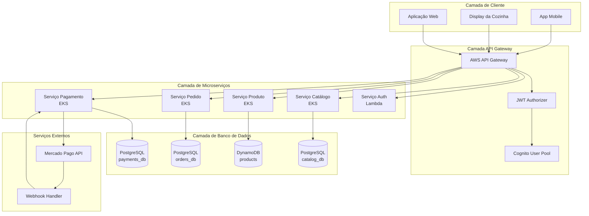

## Divisão dos Serviços

### 1. Serviço Auth (Lambda) - Sem Alterações
**Responsabilidade**: Autenticação e geração de tokens JWT via Cognito

**Banco de Dados**: Nenhum (chama Serviço Catálogo para busca de cliente)

**Endpoints**:
- `POST /auth/identify` - Identificar cliente por CPF

### 2. Serviço Catálogo / Produto (EKS + DynamoDB) - NOVO
**Responsabilidade**: Gerenciamento de clientes, categorias e produtos

**Banco de Dados**: DynamoDB (catalog_db)
- Tabelas: customers, categories, products

**Endpoints**:
- `GET /api/customers` - Listar todos os clientes
- `GET /api/customers/:id` - Buscar cliente por ID
- `GET /api/customers/cpf/:cpf` - Buscar cliente por CPF (para Serviço Auth)
- `POST /api/customers` - Criar cliente
- `PUT /api/customers/:id` - Atualizar cliente
- `DELETE /api/customers/:id` - Deletar cliente
- `GET /api/categories` - Listar categorias
- `GET /api/categories/:id` - Buscar categoria
- `POST /api/categories` - Criar categoria
- `PUT /api/categories/:id` - Atualizar categoria
- `DELETE /api/categories/:id` - Deletar categoria
- `GET /api/products` - Listar produtos
- `GET /api/products/:id` - Buscar produto
- `GET /api/products/category/:categoryId` - Buscar produtos por categoria
- `POST /api/products` - Criar produto
- `PUT /api/products/:id` - Atualizar produto
- `DELETE /api/products/:id` - Deletar produto

### 3. Serviço Gerenciamento de Pedidos (EKS + PostgreSQL)
**Responsabilidade**: Ciclo de vida dos pedidos e operações da cozinha

**Banco de Dados**: PostgreSQL (orders_db)

**Endpoints**:
- `GET /api/orders` - Listar todos os pedidos
- `GET /api/orders/:id` - Buscar pedido por ID
- `GET /api/orders/customer/:customerId` - Buscar pedidos por cliente
- `GET /api/orders/status/:status` - Buscar pedidos por status
- `GET /api/orders/sorted` - Buscar pedidos ordenados para cozinha
- `POST /api/orders` - Criar pedido
- `PATCH /api/orders/:id/status` - Atualizar status do pedido
- `PATCH /api/orders/:id/items` - Adicionar itens ao pedido
- `PATCH /api/orders/:orderId/items/:itemId` - Atualizar quantidade do item
- `DELETE /api/orders/:id` - Deletar pedido (apenas PENDING)
- `PATCH /api/orders/:id/status/confirmOrder` - Confirmar pedido
- `PATCH /api/orders/:id/status/startPreparing` - Iniciar preparo
- `PATCH /api/orders/:id/status/markReady` - Marcar como pronto
- `PATCH /api/orders/:id/status/markDelivered` - Marcar como entregue
- `PATCH /api/orders/:id/status/cancel` - Cancelar pedido
- `GET /api/kitchen/orders` - Visualização da cozinha (pedidos ordenados)
- `GET /api/kitchen/orders/awaiting-preparation` - Aguardando preparo

### 4. Serviço Pagamento (EKS + PostgreSQL)
**Responsabilidade**: Processamento de pagamentos e integração Mercado Pago

**Banco de Dados**: PostgreSQL (payments_db)

**Endpoints**:
- `POST /api/orders/:orderId/payment` - Criar pagamento (gerar QR code)
- `GET /api/payments/order/:orderId/status` - Buscar status do pagamento
- `POST /webhooks/paymentwebhook` - Webhook Mercado Pago (público)

## Fluxo de Autenticação

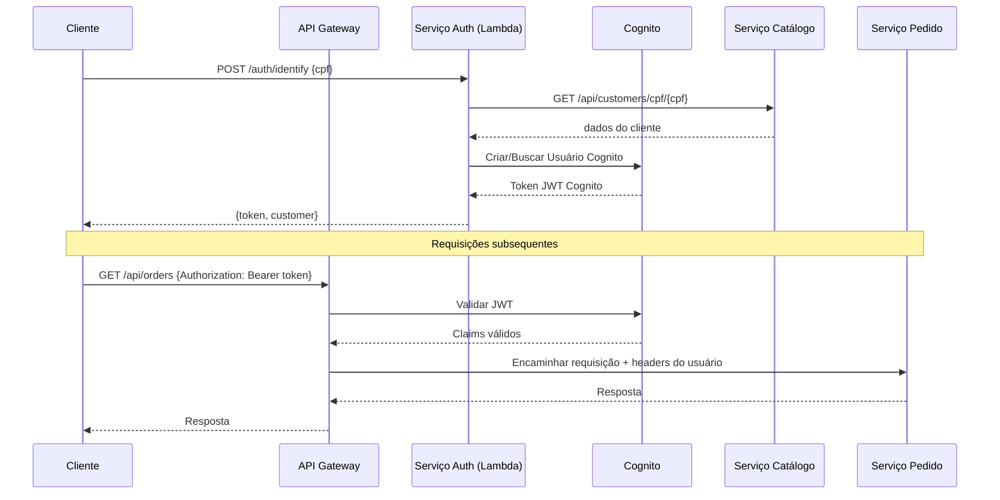

## Arquitetura de Banco de Dados

### Bancos SQL (PostgreSQL)

#### Banco do Serviço Catálogo
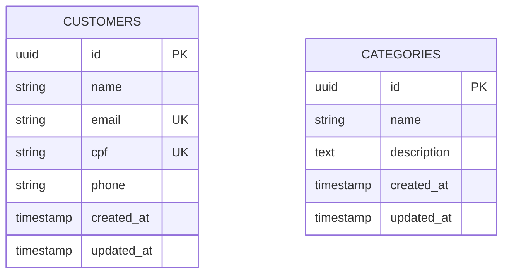

#### Banco do Serviço Pedidos
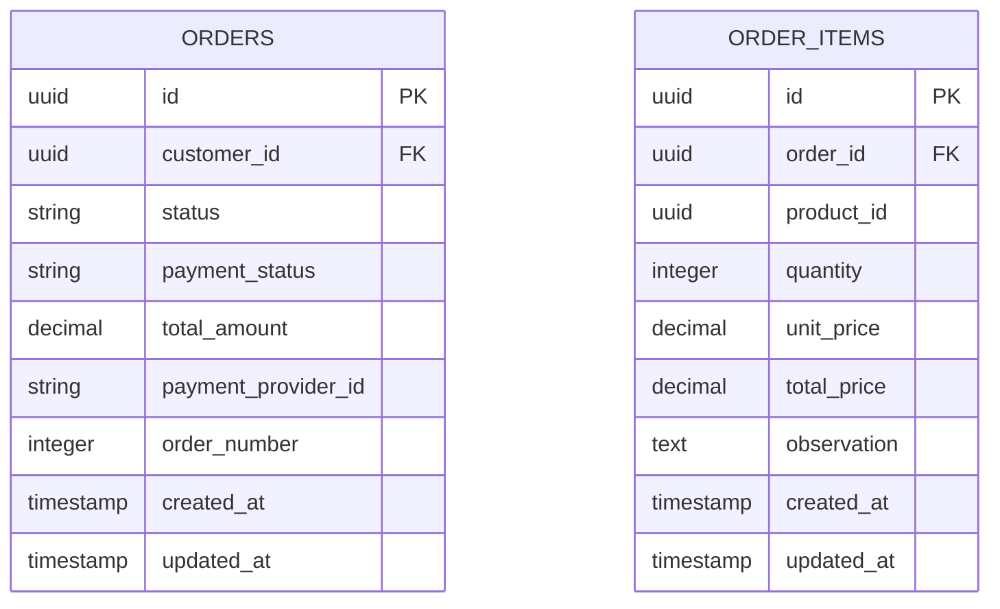

#### Banco do Serviço Pagamento
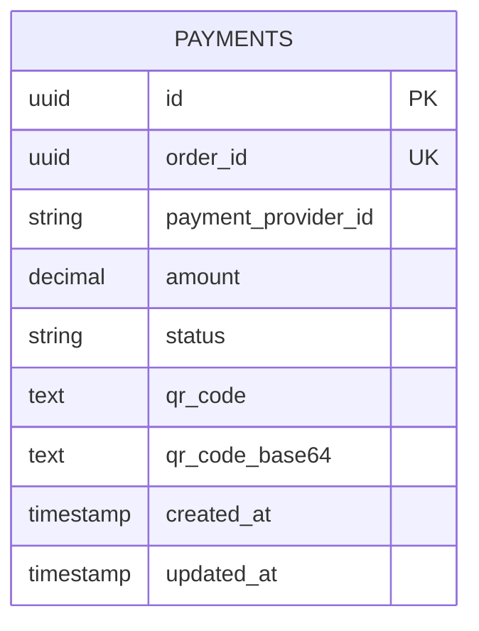

### Banco NoSQL (DynamoDB)

#### Serviço Produto - Design da Tabela DynamoDB
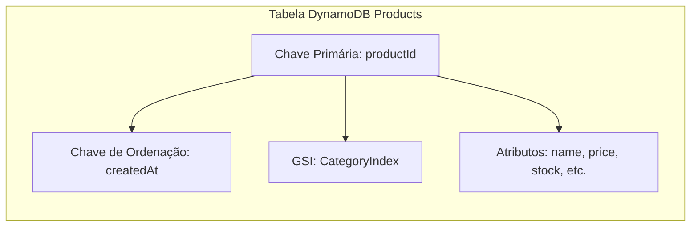

**Esquema da Tabela:**
- **Chave Primária**: `productId` (String)
- **GSI**: `CategoryIndex` com `categoryId` (Chave de Partição) e `name` (Chave de Ordenação)
- **Atributos**: name, description, price, categoryId, imageUrl, isAvailable, stock, metadata

## Comunicação Entre Serviços

### Fluxo de Criação de Pedido
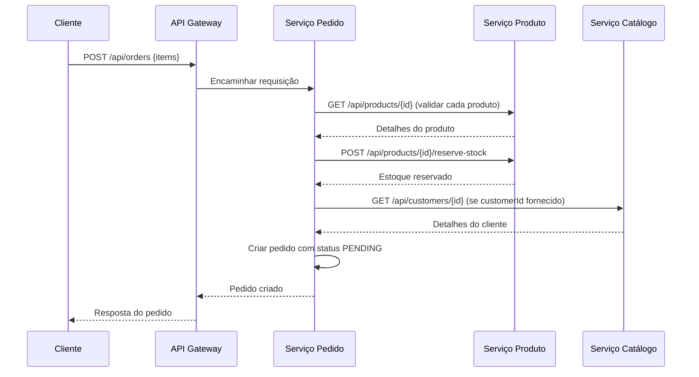

### Fluxo de Pagamento
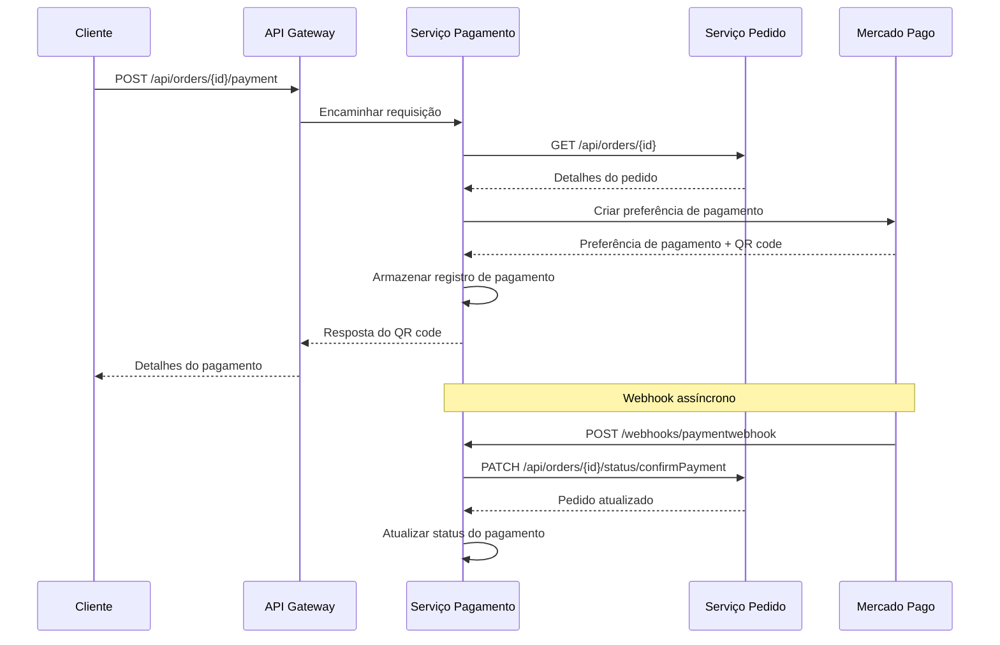

## Configuração do API Gateway

### Regras de Roteamento
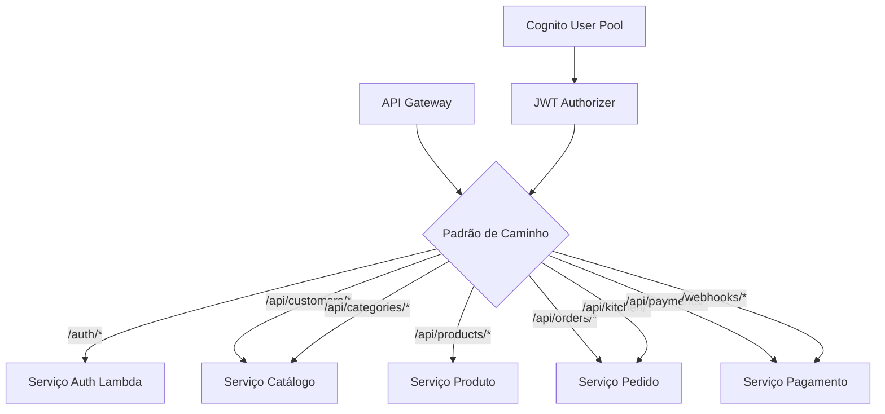

### Configuração de Segurança
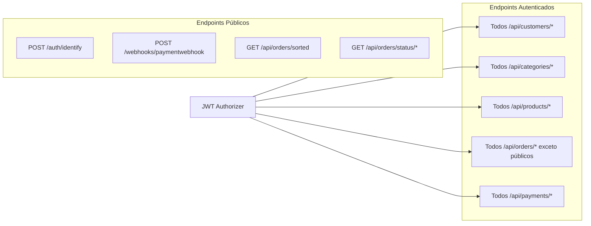

## Arquitetura de Infraestrutura

### Recursos AWS
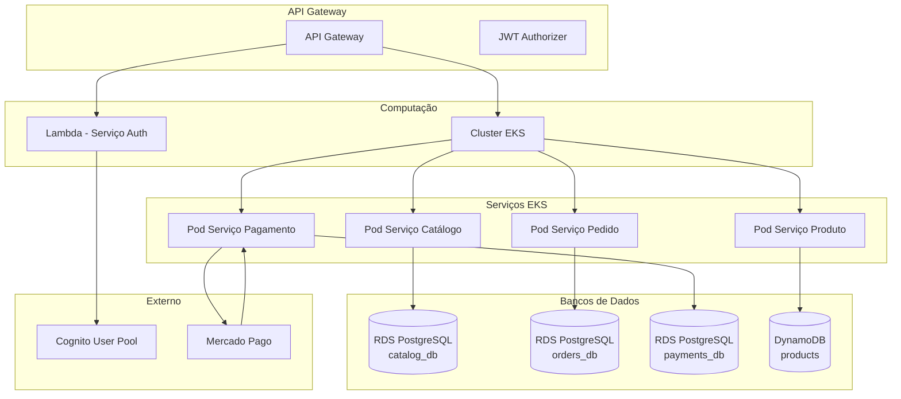

## Arquitetura de Segurança

### Estrutura do Token JWT
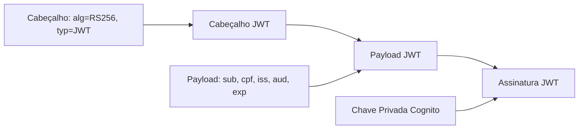

### Fluxo de Segurança do API Gateway
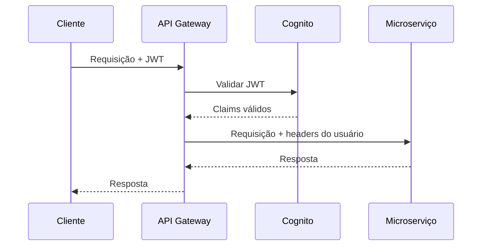

## Lista de Verificação de Implementação

- [ ] Configurar 3 instâncias RDS PostgreSQL
- [ ] Criar tabela DynamoDB products
- [ ] Atualizar Terraform para nova infraestrutura
- [ ] Configurar API Gateway com JWT authorizer
- [ ] Extrair Serviço Catálogo (clientes, categorias)
- [ ] Extrair Serviço Produto (DynamoDB)
- [ ] Extrair Serviço Gerenciamento de Pedidos
- [ ] Extrair Serviço Pagamento
- [ ] Atualizar Lambda para usar Cognito
- [ ] Configurar comunicação serviço-a-serviço
- [ ] Implementar health checks
- [ ] Configurar monitoramento e logging
- [ ] Criar pipelines de deploy
- [ ] Testar fluxos end-to-end
- [ ] Deploy em produção
- [ ] Descomissionar monólito

Esta arquitetura fornece uma solução de microserviços escalável, manutenível e segura que atende a todos os requisitos mantendo a complexidade gerenciável.
